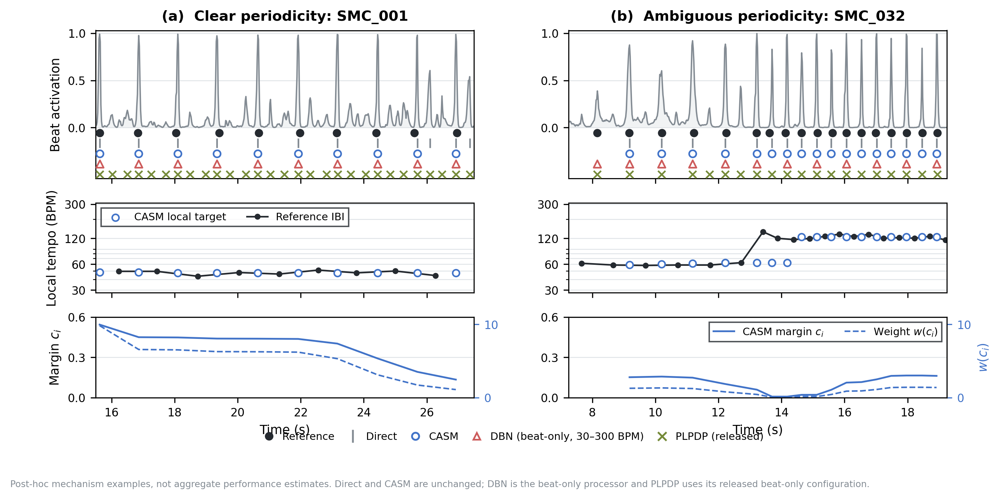
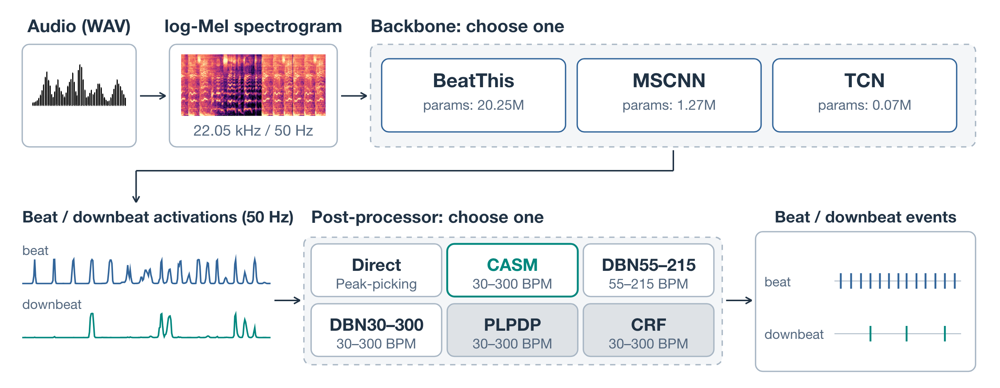

<div align="center">

## CASM: Context-Aware Semi-Markov Post-Processor For Beat Tracking

[](https://zhanh-he.github.io/casm-beat-tracking/)
[](https://github.com/zhanh-he/casm-beat-tracking/releases)
[](https://arxiv.org/abs/2610.09318)
[](mirex2026/ABSTRACT.md)

</div>

CASM is a semi-Markov decoder for framewise beat and downbeat activations. This repository contains the pip CASM package, a WAV-to-events interface, and the [interactive audio demo](https://zhanh-he.github.io/casm-beat-tracking/).

- Our paper introduces the method and submitted to **ICASSP2027** (regular 8-fold cross-validation).
- We also apply it in **MIREX2026** challenge, the required setup is different (not 8-fold, retrained BeatThis/ MSCNN/ TCN). **This is not a repeat conference-paper submission** [PDF].

<!-- Editable Figure 2 source: experiments/figures/readme/mirex-system.pptx. -->
<p align="center">
  
</p>
<p align="center"><sub>CASM performance · Paper Figure 1</sub></p>

<p align="center">
  
</p>
<p align="center"><sub>MIREX 2026 · System overview</sub></p>
## Get started

For an activation array, install the lightweight decoder and use the
madmom-style processor described in [the CASM guide](casm/README.md):

```bash
python -m pip install 'git+https://github.com/zhanh-he/casm-beat-tracking.git'
```

For an audio file, use the [inference guide](mirex2026/README.md). It offers
BeatThis, MSCNN, and TCN under separate ICASSP and MIREX weight protocols,
with Direct, DBN, and CASM postprocessing. Model checkpoints are distributed
through [GitHub Releases](https://github.com/zhanh-he/casm-beat-tracking/releases),
not embedded in the Git history. The tiny `tcn-mirex.ckpt` is included as a
working example; larger weights go beside it in `mirex2026/weights/` after
download. The ICASSP package is limited to fold 0 for inspection and **does
not reproduce the paper's complete eight-fold table**.

## What is in this repository?

| Folder | Contents |
|---|---|
| [`casm/`](casm/) | Standalone decoder, 7F paper default, API documentation, tests. |
| [`mirex2026/`](mirex2026/) | Public inference interface and six protocol-labelled model choices. |
| [`experiments/`](experiments/) | Human-readable ICASSP results and selected figures. |
| [`online-demo/`](online-demo/) | Source for the GitHub Pages listening demo. |

The BeatThis architecture and audio frontend come from
[CPJKU/beat_this](https://github.com/CPJKU/beat_this). We do not claim the
backbone as our method. ICASSP evaluates the paper's eight-fold protocol;
MIREX weights use a separate no-SMC/no-GTZAN development pool. Never use an
upstream `final0` or ICASSP fold weight as a held-out SMC MIREX result.

See the [paper PDF](paper_icassp2027_casm.pdf),
[result table](experiments/tables/RESULTS.md), and
[data/annotation protocol](experiments/DATA_AND_ANNOTATIONS.md) for details.
