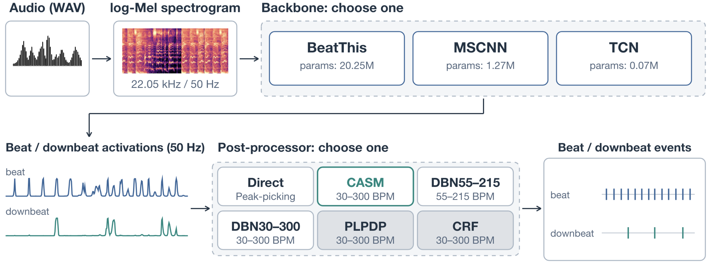
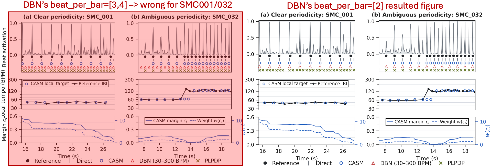

<div align="center">

## CASM: Context-Aware Semi-Markov Post-Processor For Beat Tracking

[](https://zhanh-he.github.io/casm-beat-tracking/)
[](https://github.com/zhanh-he/casm-beat-tracking/releases)
[](https://arxiv.org/abs/2610.09318)
[](https://futuremirex.com/portal/wp-content/uploads/2026/audio-beat-tracking/CASM.pdf)

</div>

CASM is a semi-Markov decoder for framewise beat and downbeat activations. This repository contains the CASM pip installation package, WAV-to-events interface, and the [online audio demo (web)](https://zhanh-he.github.io/casm-beat-tracking/).

- Our paper introduces the method and submitted to **ICASSP2027** (8-fold cross-validation, regular in beat/downbeat research field).
- We also apply our system in **MIREX2026 challenge, achieving top performance** across most evaluation sets. Since the required train/test setup is different (not 8-fold), the results here differ from our ICASSP paper.
- See our MIREX results in this [extended-abstract (pdf)](https://futuremirex.com/portal/wp-content/uploads/2026/audio-beat-tracking/CASM.pdf) and [MIREX2026 result page (web)](https://music-ir.org/mirex/wiki/2026:Audio_Beat_Tracking_Results).

<p align="center">
  <br>
  <sub>MIREX 2026 System overview</sub>
</p>

> [!NOTE]
> **About Figure 1:** 
> The under-review version used DBN's default `beats_per_bar=[3,4]` to maintain a fair comparison (resulted in left figure). However, the SMC001/032 should use `beats_per_bar=[2]` for optimal DBN performance (resulted in right figure). If been accepted, the camera-ready will update its Figure 1 to the Right-side version.
> **Key Takeaway:** This perfectly shows a weakness of DBN post-processor. Without correct manual tuning (based on prior knowledge), DBN often shows terrible performance.

<!-- Editable system diagram is on backup: archive/figure-sources/fig0-mirex-system/mirex-system.pptx. -->
<p align="center">
  <br>
  <sub>ICASSP 2027 Submitted Paper Figure 1</sub>
</p>

## Get started

For an activation array, install the lightweight decoder and use the
madmom-style processor described in [the CASM guide](casm/README.md):

```bash
python -m pip install 'git+https://github.com/zhanh-he/casm-beat-tracking.git'
```

## How to use
For an input audio file, please refer to the [inference guide](mirex2026/README.md). It supports BeatThis, MSCNN, and TCN backbones under both ICASSP and MIREX weight protocols, with options for Direct peak-picking, CASM, and DBN post-processing. The full model checkpoints are distributed via [GitHub Releases](https://github.com/zhanh-he/casm-beat-tracking/releases). 

The included `mirex2026/weights/tcn-mirex.ckpt` is a small MIREX inference example.
Download larger checkpoints from Releases into the same folder. See the
[weight inventory](mirex2026/weights/README.md) for availability.

- **ICASSP 8-fold protocols:** The inference interface accepts fold-0 examples. The current public Release contains the MIREX package; additional ICASSP checkpoints can be requested by email. A single fold does not reproduce the full eight-fold table.
- **MIREX challenge protocol:** Separate, fully trained model checkpoints are provided. We use a 9:1 train/validation split on the training set, while the test set is held out and evaluated by the MIREX organizers.

## What is in this repository?

| Folder | Contents |
|---|---|
| [`casm/`](casm/) | Proposed post-processor and its default setup & API documentation. |
| [`mirex2026/`](mirex2026/) | MIREX2026 submitted system and its interface. |
| [`experiments/`](experiments/) | ICASSP experiment results and analysis figures. |
| [`online-demo/`](online-demo/) | Source for the online listening demo. |

The BeatThis architecture and audio frontend come from
[CPJKU/beat_this](https://github.com/CPJKU/beat_this). We do not claim the
backbone as our method. ICASSP evaluates the paper's eight-fold protocol;
MIREX weights use a separate no-SMC/no-GTZAN development pool. Never use an
upstream `final0` or ICASSP fold weight as a held-out SMC MIREX result.

See the [paper on arXiv](https://arxiv.org/abs/2610.09318),
[result table](experiments/tables/RESULTS.md), and
[data/annotation protocol](experiments/DATA_AND_ANNOTATIONS.md) for details.

## Acknowledgement and Contact
Our work is inspired by the PLPDP post-processor “Local Temporal Expectation-based Beat Tracking for Expressive Classical Piano Music” [[GitHub]](https://sunnycyc.github.io/plpdp4beat-demo/). Thanks their authros' fantastic online demo presentation and well-build experiment workflow.

Any question please contact: zhanh.he.uwa@gmail.com
